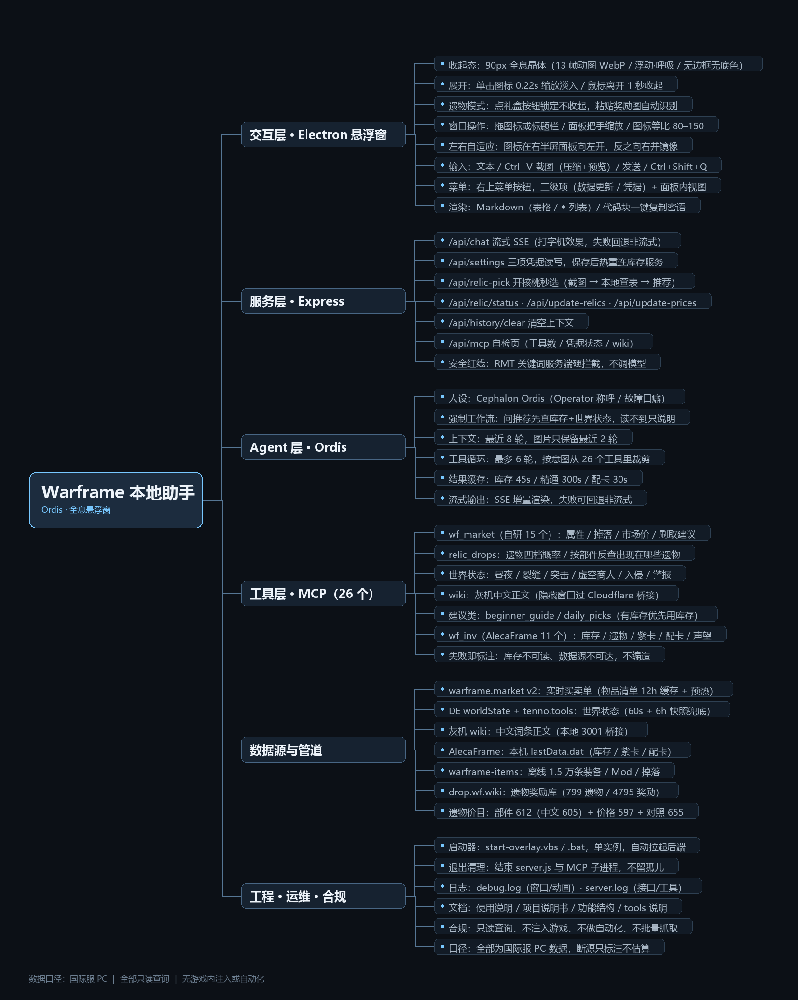

# Ordis Overlay · Warframe 本地 AI 助手

一个跑在 Windows 桌面上的 Warframe 悬浮助手：**透明无边框小图标 → 点开是磨砂 HUD 面板**，
背后接 DeepSeek 模型与两个本地 MCP 数据服务，查价格、查掉落、查世界状态、看开核桃奖励、算配卡。

- 只做**只读查询**与文本建议，不注入游戏、不自动化操作、不修改游戏文件
- 数据口径统一为**国际服 PC**
- 查不到就直说，不编价格、不编掉率、不编库存



---

## 功能一览

| 模块 | 能做什么 |
|---|---|
| 市场行情 | 实时最低价 / 在线中位价 / 卖家列表 / 可直接复制的密语 |
| 装备数据 | 战甲与武器的生命护盾护甲、暴击触发、攻击模式、紫卡倾向、掉落来源 |
| 世界状态 | 希图斯 / 福尔图娜 / 魔胎之境昼夜、虚空裂缝、突击、虚空商人、入侵、警报 |
| 遗物 | 某遗物出什么（四档精炼概率）、按部件反查遗物、**开核桃秒选**（截图 → 推荐） |
| 库存 | 读取 AlecaFrame 本地缓存：白金、遗物、已拥有装备、配卡、紫卡、声望 |
| wiki | 灰机中文 wiki 正文（本地桥接，过 Cloudflare） |
| 新手/日常 | 起步路线建议、今日推荐（市场价 + 掉落 + 世界状态） |
| 界面 | 点击展开、拖标题栏移动、双把手缩放、左右自动开向、`Ctrl+V` 贴图、Markdown + 代码块一键复制 |

---

## 快速开始

### 1. 环境

- Windows 10/11 x64
- 一个 [DeepSeek](https://platform.deepseek.com/) API Key

> 不需要单独装 Node.js——运行期用的是 Electron 自带的 Node。

### 2. 安装

```bash
npm install        # 主依赖（Electron / Express / OpenAI / MCP SDK）
npm run setup      # 可选依赖一键装（离线装备库 80MB + 世界状态解析器 32MB）
npm run doctor     # 体检：缺什么、怎么补、缺了会怎样
```

- `npm run setup` 会依次在 `tools/warframe-mcp` 和 `tools/worldstate` 里跑 `npm install`，任何一步失败都不中断，最后自动跑一次体检。
- `tools/warframe-inv.exe` 是二进制，不随仓库发布，`setup` 只会检查并提示，不影响其他功能。
- `npm run doctor` 逐项列出依赖、数据表、凭据、缓存是否就绪，缺哪项直接给补救命令。

### 3. 填 Key

把 `config.example.json` 复制成 `config.json`，填入你的 Key：

```json
{ "apiKey": "sk-xxxxxxxxxxxxxxxx" }
```

也可以启动后在面板右上角 **菜单 → API 凭据** 里填，保存即生效。

### 4. 启动

双击 `start-overlay.vbs`（无黑框），或：

```bash
npm start
```

右下角出现全息晶体的那一刻就绪；点它展开面板。

退出：菜单 → 退出，或 `Ctrl+Shift+Q`。

---

## 可选依赖（不装也能用，只是少功能）

前两项由 `npm run setup` 自动安装；后两项需要你自己准备。

| 依赖 | 用途 | 怎么装 | 不装会怎样 |
|---|---|---|---|
| `tools/warframe-mcp/node_modules/warframe-items` | 离线装备库（1.5 万条） | `npm run setup`（或 `cd tools/warframe-mcp && npm install`） | 属性/掉落/配卡等工具失联；**市场价、世界状态、wiki、开核桃秒选仍然可用** |
| `tools/worldstate/node_modules` | DE 世界状态解析器 | `npm run setup`（或 `cd tools/worldstate && npm install`） | 退回 tenno.tools 备用源，缺魔胎之境昼夜 |
| AlecaFrame | 读取你的库存 / 白金 / 遗物 / 紫卡 | 装 Overwolf + AlecaFrame，登录并同步一次；`userHash` / `publicToken` 填在面板「API 凭据」 | 问库存会明确回复「无法读取本地库存」 |
| `tools/warframe-inv.exe` | 库存 MCP 服务本体 | 不随仓库发布（二进制），自行构建后放到 `tools/` | 同上，库存类功能不可用 |

不确定缺哪项，直接跑 `npm run doctor`，它会逐条告诉你。

---

## 目录结构

```
overlay-demo/
├─ src/                     # 应用源码
│  ├─ main.js               # Electron 主进程：窗口、穿透、拖拽、wiki 桥接、后端子进程
│  ├─ index.html            # 渲染层：图标 + 面板 + 二级视图
│  ├─ style.css             # 全部样式（磨砂 HUD 主题）
│  ├─ server.js             # Express：/api/chat 流式、/api/settings、/api/relic-*
│  └─ lib/
│     ├─ config.js          # 路径、模型、API Key、MCP 服务表
│     ├─ mcp.js             # MCP 连接管理、工具路由、结果缓存
│     ├─ agent.js           # Ordis 人设提示词、上下文、工具循环、流式请求
│     └─ relic.js           # 开核桃秒选：OCR → 本地查表 → 排序
├─ scripts/                 # 数据更新脚本
│  ├─ update_relic_rewards.js   # drop.wf.wiki → 遗物奖励库
│  ├─ update_relic_parts.js     # 部件表 + 中文名 + market slug
│  ├─ update_relic_prices.js    # 市场价（中位数 + 剔钓鱼单）
│  ├─ build_zh_map.js           # 灰机 wiki → 中英名称表
│  ├─ fill_zh_search.js         # 用 wiki 搜索补中文名
│  └─ make_mindmap.py           # 生成功能结构导图
├─ data/                    # 数据表（随仓库发布）
│  ├─ all_relics.json       # 612 条部件（含中文名、杜卡德、slug）
│  ├─ relic_prices.json     # 597 条市场价
│  ├─ relic_rewards.json    # 799 个遗物 / 4795 条奖励
│  └─ relic_zh.json         # 655 条中英对照
├─ tools/                   # MCP 服务（wf-mcp-lite 自研；其余按需放置）
├─ vendor/                  # marked.min.js（离线 Markdown 渲染）
├─ assets/                  # 图标
├─ docs/                    # 使用说明 / 项目说明书 / 功能结构
├─ config.example.json
├─ start-overlay.vbs / .bat
└─ package.json
```

---

## 数据更新

面板：菜单 → 数据更新，有「更新部件信息」「更新价格信息」两个按钮。

命令行：

```bash
npm run update:relic-rewards   # 遗物奖励库（drop.wf.wiki）
npm run update:relic-parts     # 部件表（离线库 + 奖励库补全 + 中文名）
npm run update:relic-prices    # 市场价（约 2–6 分钟）
npm run update:zh              # 中英名称表（需要悬浮窗开着，走本地 wiki 桥接）
npm run update:all             # 上面三个数据表依次跑
```

**价格防钓鱼**：取最便宜 8 个在售单算中位数，剔除低于中位数 30% 的挂单，再取一次中位数。

---

## 架构

```
Electron 主进程 (src/main.js)
├─ 悬浮窗：透明置顶 / 点击穿透 / 拖拽 / 缩放 / 左右开向
├─ 本地桥接 :3001 → 灰机 wiki（隐藏窗口过一次 Cloudflare，再同源 fetch）
└─ 启动 / 回收后端 :3000

Express (src/server.js)
├─ POST /api/chat        SSE 流式对话（工具循环 + 上下文）
├─ GET/POST /api/settings DeepSeek Key / AlecaFrame 凭据，热重连
├─ POST /api/relic-pick  截图 → 本地查表 → 推荐
├─ POST /api/update-relics / update-prices  触发数据脚本
└─ GET  /api/mcp         自检（工具数、凭据、wiki 状态）

Agent (src/lib/agent.js)
└─ Ordis 人设 → 按意图裁剪工具 → 最多 6 轮工具循环 → 流式输出

MCP
├─ wf_market（自研 15 个工具）：market v2 / DE worldState + tenno.tools / wiki / 离线库
└─ wf_inv（11 个工具）：AlecaFrame 本地缓存
```

---

## 已知限制

- `api.warframestat.us`、Overframe、Reddit、`raw.githubusercontent.com` 在部分网络下不可达，相关工具已下线或改走别的源
- 灰机 wiki 需要悬浮窗运行才能取正文（桥接在进程内）
- 4 个数据表随仓库发布，行情会过期，建议每周跑一次 `update:relic-prices`
- 泥瓦匠（Kavasa）等少数历史命名在 market 上没有对应条目，会显示「未知」

---

## 合规

- 本项目**只读**公开数据，不读取游戏内存、不注入进程、不修改游戏文件
- 不提供代充、代练、账号交易等任何 RMT 相关内容，相关提问会被服务端硬拦截
- Warframe 及相关名称、图像版权归 Digital Extremes 所有；本工具为非官方、非商业的个人辅助工具
- 第三方数据来自 warframe.market、drop.wf.wiki、灰机 wiki、warframe-items 等，请遵守各自条款，不要高频抓取

---

## 许可

MIT（见 [LICENSE](LICENSE)）。第三方组件许可见 `docs/使用说明与合规声明.md` 第 6 章。
